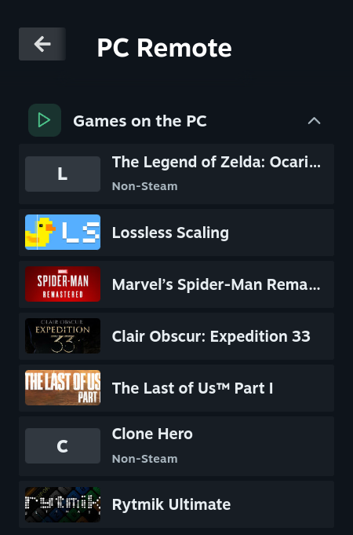
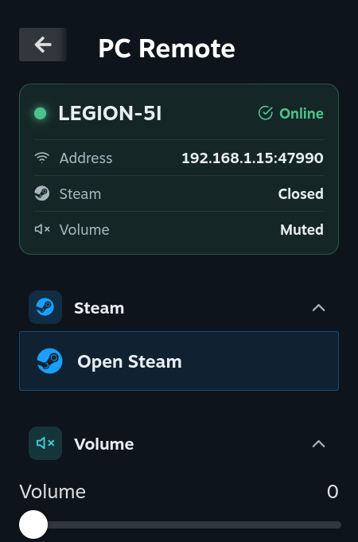
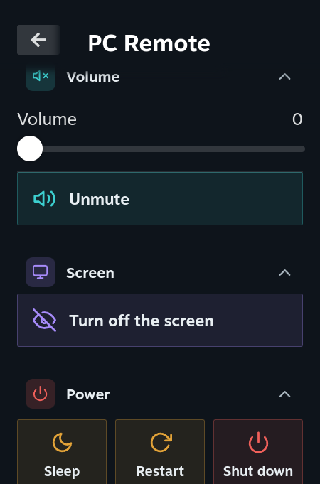
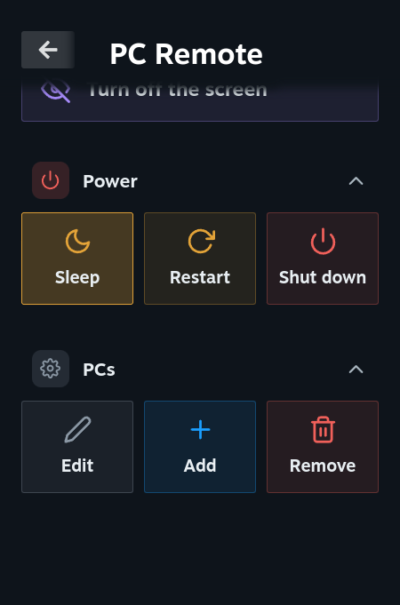

# PC Remote (Decky plugin)

A remote for your Windows PC in the Steam Deck's Quick Access Menu (`…`). Made for the couch:
you stream from the PC with Steam Link / Remote Play and want to open Steam, set the volume,
turn the screen off or put the PC to sleep without walking to the desk.

<p>
  
  
  
  
</p>

## What it does

| Section | Controls |
|---|---|
| **Status** | Online / Offline / Connecting at a glance, with the PC's address, whether Steam is open, and the volume |
| **Games on the PC** | The Steam games installed on the PC and its non-Steam shortcuts (emulators, launchers), last played first, with a *Playing* badge on the running one. Collapsed by default; pressing a game opens its page in the Deck's library, where Steam offers **Stream** |
| **Steam** | Open Steam, or close it when it is running |
| **Volume** | A slider for the PC's speakers and a Mute / Unmute button |
| **Screen** | Turn the PC's screen off (moving the mouse or a key wakes it) |
| **Power** | Sleep, Restart, Shut down, each asking to confirm first |
| **PCs** | Edit, add or remove PCs, and switch between them when you have more than one |

- Only the games list collapses (its header shows how many games are installed); the Deck
  remembers whether you keep it open.
- The games list is read from the PC's Steam library files, so it works with Steam closed;
  when Steam is closed the list offers to open it, since streaming needs it running.
- Non-Steam games come from the PC's `shortcuts.vdf`; the Deck knows them (same app id) only
  while Steam runs on the PC, so they open once Steam is up there.
- On a game the Deck could also install, Steam's main button reads **Install**: the arrow next
  to it offers **Stream** from the PC.
- Every action has an icon and a colour family: blue for Steam, teal for sound, violet for
  the screen, amber for sleep and restart, red for shut down.
- Buttons show a spinner while their command runs; failures appear as a toast.
- **Search the network** in the PC form fills in the PC's name and address, so the only thing
  to type is the token.
- If DHCP gives the PC a new IP, the plugin finds it again by name and carries on.
- Built to be used with the controller alone: the D-pad moves through sections and tiles.

## How it works

| Part | Where | What |
|---|---|---|
| `agent/` | Windows PC | A small PowerShell HTTP server on port 47990, started hidden at logon in your session, protected by a token |
| plugin (`src/`, `main.py`) | Steam Deck | The Decky panel; its Python backend calls the agent and finds it on the LAN |

The agent runs in your Windows session (a logon task, no window) rather than as a Windows
service: a service lives in a separate session without a desktop, where it could neither open
Steam on your screen nor turn the display off.

## Install

### 1. PC (Windows)

In PowerShell, from this repository:

```powershell
powershell -ExecutionPolicy Bypass -File agent\install.ps1
```

It copies the agent to `%APPDATA%\pc-remote`, creates a token, registers the logon task
"PC Remote Agent" (run through `conhost --headless`, so no window appears), starts it, and adds
Windows Firewall rules for private networks: TCP for commands, UDP for discovery (one
administrator prompt). At the end it prints the PC's **IP** and **token**.

Running it again updates the agent and keeps the token. Remove everything with
`agent\uninstall.ps1`.

### 2. Steam Deck

Build the zip (or take it from a release):

```bash
npm install
npm run build
```

Put `plugin.json`, `main.py`, `package.json`, `LICENSE` and `dist/index.js` in a `PC Remote/`
folder, zip it, then on the Deck: **Decky → Settings → Developer → Install Plugin from ZIP File**.

Open `…` → **PC Remote** → **Add a PC**, press **Search the network**, and type the token.

## Agent API

Every HTTP request needs the header `X-Token: <token>`.

| Request | Effect |
|---|---|
| `GET /status` | `{"host","steam","volume","muted"}` |
| `GET /games` | `{"running","games":[{"appid","name","lastPlayed","nonSteam"}]}`: fully installed Steam games (tools and runtimes left out) and visible non-Steam shortcuts |
| `POST /steam/open`, `POST /steam/close` | Opens Steam, or closes it with `steam.exe -shutdown` |
| `POST /screen/off` | Turns the displays off |
| `POST /power/suspend`, `/power/restart`, `/power/shutdown` | Power actions, 1.5 s after the reply |
| `POST /volume?level=0..100` | Sets the default output device's volume (and unmutes) |
| `POST /mute` | Toggles mute |
| UDP datagram `PCREMOTE_DISCOVER` to port 47990 | Answers `{"name","port"}`; needs no token and reveals nothing secret |

## Network and security

Local network only. The firewall rules cover private networks, and the token is the only
protection, so don't forward the port to the internet. To reach the PC away from home, put the
PC and the Deck on a VPN such as Tailscale and add the PC with its VPN address.

## Development

`PRODUCT.md` holds the design intent (users, principles, anti-references). The panel's visual
vocabulary (tones, tiles, collapsible sections) lives in `src/ui.tsx`.
